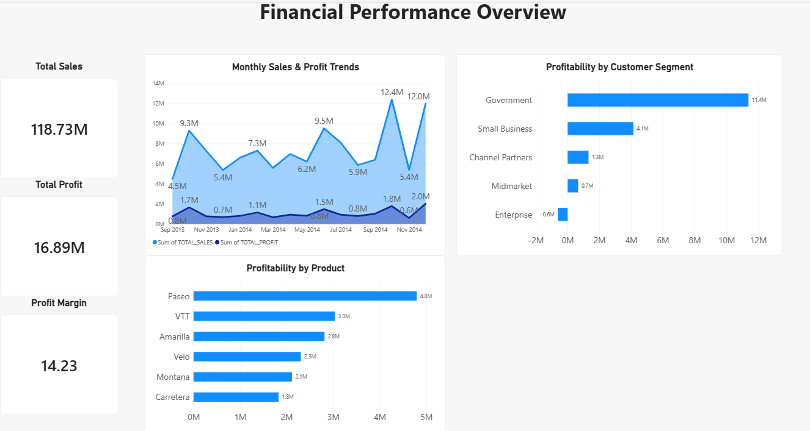
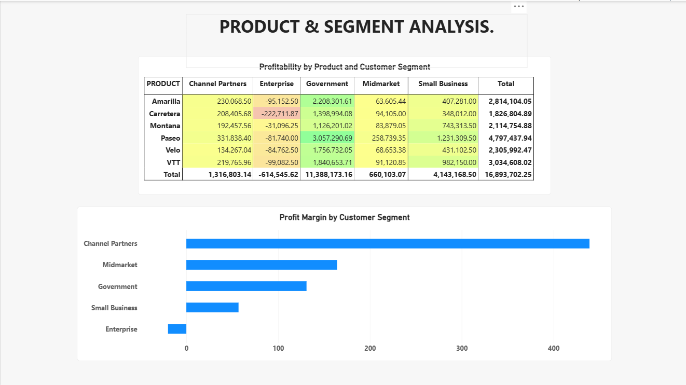

# Financial Performance & Revenue Analytics

An end-to-end data analytics and engineering portfolio project focused on financial performance, revenue trends, product profitability, and customer-segment analysis using Python, PySpark, Snowflake, dbt, SQL, and Power BI.

**GitHub Repository:** [financial-performance-analytics](https://github.com/jis23nu/financial-performance-analytics)

## Project Overview

This project demonstrates an end-to-end analytics workflow, from raw financial data preparation to cloud data warehousing, tested data transformations, and interactive business intelligence dashboards.

The objective is to understand financial performance, identify profitable products and customer segments, and highlight areas that may require business attention.

## Technology Stack

- **Python and Pandas** — Data cleaning, exploratory analysis, and financial calculations.
- **PySpark** — Data processing and validation.
- **Snowflake** — Cloud data warehousing and SQL analytics.
- **dbt** — Modular data transformation, analytical models, and data quality testing.
- **SQL** — Financial aggregations and analytical queries.
- **Power BI** — Interactive dashboards and business reporting.
- **Git and GitHub** — Version control and project documentation.

## Dataset

The project uses Microsoft's Financial Sample dataset.

- **Records:** 700
- **Columns:** 16
- **Source format:** Excel workbook
- **Processed format:** Cleaned CSV
- **Key business dimensions:** Product, Segment, Country, Discount Band, Month, and Year.
- **Key financial measures:** Sales, Gross Sales, Profit, COGS, Discounts, Units Sold, Manufacturing Price, and Sale Price.

The original workbook is maintained locally and is not included in the Git repository.

## Project Workflow

1. **Data preparation:** Cleaned the dataset, standardized column names, and handled missing discount-band values.
2. **Exploratory analysis:** Used Pandas to examine sales, profit, profit margins, products, segments, countries, and monthly trends.
3. **Data processing:** Used PySpark to process and validate the cleaned dataset.
4. **Data warehousing:** Loaded 700 records into Snowflake.
5. **Data transformation:** Created staging and analytical models using dbt.
6. **Data quality:** Executed dbt tests to validate transformed data.
7. **Business intelligence:** Built Power BI dashboards to present financial KPIs, trends, and profitability comparisons.

## Key Financial Results

| Metric | Result |
|---|---:|
| Total Sales | $118.73M |
| Total Profit | $16.89M |
| Overall Profit Margin | 14.23% |
| Records Analyzed | 700 |

*Values are rounded for presentation.*

## Key Business Insights

- **Product profitability:** Paseo generated approximately $4.80M in profit, the highest total profit among the products in this analysis.
- **Highest product margin:** Amarilla recorded a profit margin of approximately 15.86%.
- **Lowest product margin:** Velo recorded a profit margin of approximately 12.64%.
- **Enterprise segment:** Recorded a loss of approximately $614.5K and a profit margin of -3.13%.
- **Government segment:** Achieved a profit margin of approximately 21.69%.
- **Small Business segment:** Recorded a profit margin of approximately 9.77%.
- **Channel Partners:** Recorded a calculated margin of approximately 73.13%. This unusually high result merits additional validation and investigation.
- **Time-period limitation:** The dataset covers September through December in 2013 but the full year in 2014. Direct year-over-year comparisons should account for the difference in coverage.

These findings describe the analyzed dataset and should be interpreted in the context of its scope and time coverage.

## Snowflake and dbt Implementation

The Snowflake environment uses the following objects:

- **Database:** `FINANCIAL_ANALYTICS`
- **Schema:** `FINANCE`
- **Raw table:** `FINANCIAL_DATA`

The dbt project is located in `financial_performance_dbt/`.

Key analytical models include:

- **`stg_financial_data`** — Stages and standardizes source data.
- **`fct_profitability`** — Provides analytical profitability metrics.
- **`mart_segment_profitability`** — Summarizes financial performance by segment.
- **`mart_monthly_financials`** — Supports monthly financial analysis.

The project includes source definitions and data quality tests. The dbt build completed successfully with six models and six tests passing.

## Power BI Dashboards

### 1. Financial Performance Overview

This dashboard presents headline KPIs for total sales, total profit, and overall profit margin, together with monthly sales and profit trends and profitability comparisons.



### 2. Product & Segment Analysis

This dashboard includes a product-by-segment profitability matrix with conditional formatting and a customer-segment profit-margin comparison, including the negative Enterprise margin.



### Open the Power BI Report

[Open or download the Power BI report file](reports/Financial_Performance_Analytics.pbix).

Download the PBIX file and open it using Microsoft Power BI Desktop to explore the report interactively.

## Project Structure

```text
financial-performance-analytics/
├── data/
│   └── financial_sample_cleaned.csv
├── notebooks/
│   └── 01_financial_analysis.ipynb
├── financial_performance_dbt/
│   ├── models/
│   ├── tests/
│   └── dbt_project.yml
├── reports/
│   ├── Financial_Performance_Analytics.pbix
│   └── screenshots/
│       ├── financial-performance-overview.png
│       └── product-segment-analysis.png
└── README.md
```

The local source workbook, virtual environment, and additional generated files may be excluded from version control.

## Skills Demonstrated

- Data cleaning and exploratory data analysis
- Financial KPI calculation and profitability analysis
- Python, Pandas, and PySpark
- Snowflake data warehousing and SQL
- dbt modeling and data quality testing
- Power BI dashboard development
- Git, GitHub, and technical documentation

## Conclusion

This project demonstrates how data analytics and data engineering tools can work together to turn raw financial data into tested analytical models and interactive reports. It highlights revenue trends, product profitability, and customer-segment performance while identifying areas that warrant further investigation.
